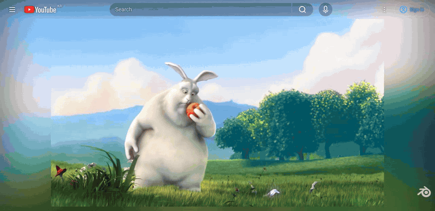

# YouTube Ambient Light For Safari

Ambient light for YouTube in Safari. The colors at the edges of the video spill onto the page around the player, a bit like bias lighting behind a TV.

 Video: <a href="https://peach.blender.org/">Big Buck Bunny</a> © Blender Foundation, CC BY 3.0

The [Ambient light for YouTube](https://github.com/WesselKroos/youtube-ambilight) extension does this in Chrome and Firefox, but there is no Safari version. So I wrote a userscript that runs in Safari with the free [Userscripts](https://apps.apple.com/app/userscripts/id1463298887) extension. It also works in YouTube web apps added to the Dock.

Tested with Safari 27 on macOS.

## Features

- Glow around the video, drawn with WebGPU (WebGL on older Safari). It uses the same edge projection and defaults as the extension, with a wider spread.
- Smooth in Safari: the glow is part of the page, so it scrolls with it instead of trailing behind, and the video frames are processed on the GPU.
- At the top of the page the glow shows through the header and the search bar. Hovering the search bar fades it back to normal.
- Readability boost, so titles, buttons and descriptions stay readable on bright videos.
- The light also falls on the comments below the video, and keeps following the video while you read them.
- Theater mode, playlists, and optional black bar removal for letterboxed videos.
- Light on resources: the glow updates 15 times a second, and with WebGPU each update crossfades into the next on the compositor, so it moves continuously. WebGPU reads the video frame straight from the decoder instead of copying it. It pauses itself when the tab is in the background, or when neither the video nor the comments are on screen. The measurements behind these choices are in [youtube-ambient-light-bench](https://github.com/neul-lov/youtube-ambient-light-bench).
- No network requests and nothing is collected. Settings are saved in your browser's local storage.

## Install (Safari on macOS)

1. Install [Userscripts](https://apps.apple.com/app/userscripts/id1463298887) from the Mac App Store and open it once.
2. In Safari, open Settings > Extensions and turn on Userscripts. Allow it on youtube.com.
3. Open the [script file](https://raw.githubusercontent.com/neul-lov/youtube-ambient-light-for-safari/main/youtube-ambient-light-for-safari.user.js) in Safari, then click the Userscripts icon in the toolbar. The popup shows an install prompt.

   You can also do it by hand: Userscripts icon > Open Extension Page > + > Create JS, paste in the contents of [`youtube-ambient-light-for-safari.user.js`](youtube-ambient-light-for-safari.user.js) and save.
4. Reload YouTube.

If you watch YouTube in a web app (File > Add to Dock), turn on Userscripts in that app's Settings > Extensions as well.

Userscripts checks the script's `@updateURL`, so new versions from this repo show up in its update list.

### Other browsers

It's written and tested for Safari, but it's a regular userscript, so Chrome, Edge and Firefox should work with Tampermonkey or Violentmonkey.

On iPhone, YouTube serves the mobile site, which isn't supported. iPad Safari loads the desktop site and may work, but I haven't tried it.

## Usage

Open any video. The sun icon in the player controls (or Shift+A) opens the settings, and A turns the glow on and off.

- **Blur, Edge size, Spread, Spread fade start, Spread fade curve**: the shape of the glow. They behave like the settings with the same names in the extension.
- **Smooth motion**: blends frames so the colors spread gently (75% by default, which hides the 15 fps steps). Lower it for a snappier glow.
- **Brightness, Contrast, Saturation**: colors of the glow.
- **Use dark theme**: switches YouTube to dark mode on video pages. The glow looks much better on black.
- **Transparent header at the top, Glow through the search bar**: let the glow show behind the top bar.
- **Readability boost**: text shadows and darker buttons. 0% turns it off.
- **Glow on the comments**: how strongly the video's colors light up the comments. 0% turns it off.
- **Remove black bars**: ignores letterboxing when picking colors.
- **Frame rate limit**: how often the glow updates (15 by default). Higher values follow the video more closely but use more CPU.
- **GPU acceleration, Use WebGPU**: leave both on unless the glow doesn't show up at all. Without WebGPU (or on Safari versions without it) the glow is drawn with WebGL.
- **Crossfade between updates**: with WebGPU, each update fades in over the previous one, so the glow moves continuously. Turn it off to save a little more CPU; Smooth motion still softens the steps.

The settings panel is in English, or in Korean when YouTube itself is set to Korean.

## Notes

- The glow is turned off in fullscreen.
- YouTube changes its page layout fairly often. If something looks wrong, please open an issue.

## Credits

The edge projection, the spread fade and the default values are adapted from Ambient light for YouTube by Wessel Kroos (MIT license, see [LICENSE](LICENSE)). This project is not affiliated with that extension.

Not affiliated with YouTube or Google. YouTube is a trademark of Google LLC.

## License

[MIT](LICENSE)
